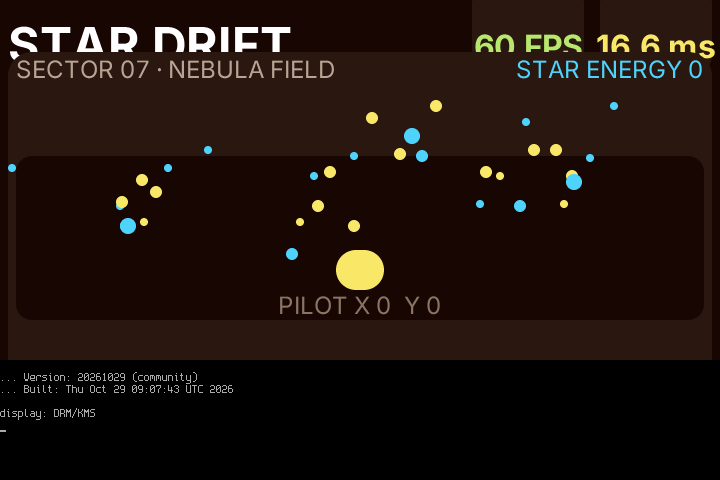

# Star Drift — PocketJS FPS demo

A small handheld game demonstrating PocketJS's native view tree, Solid signals, gamepad input, frame driven motion, and a live FPS / frame time HUD.



This is a direct 720×480 framebuffer capture. The HUD read 60 FPS and 16.6 ms per frame. The installed runtime profile uses a 360×240 logical viewport at 2× raster density. FPS is an observed cadence snapshot from PocketJS virtual frame ticks; it is not a GPU benchmark or a guaranteed refresh rate.

## Play

- D-pad: move the pilot.
- A / CROSS: boost.
- B / CIRCLE: reset the score.
- Collect the drifting stars.

## Build

Compile with the PocketJS checkout and the H700 runtime profile:

```sh
bun tools/pocket.ts compile \
  --runtime-config programs/linux-kms-h700/pocket.runtime-config.ts \
  --target rocknix-h700-kms \
  --manifest apps/star-drift/pocket.json \
  --output star-drift.pocket
```

`star-drift.pocket` is generated and is not committed. The package was admitted by the installed H700 runtime with profile hash `sha256:85385701f8dde49f563eb578c67de330562c219b2c7924fce09a15801819bcb0`.

## Install and launch

Copy the package into the game library and it shows up in the launcher:

```sh
cp star-drift.pocket /storage/content/games/misc/
```

The device's `pocketshell-games` scanner indexes `.pocket` packages as games
(`kind: "pocketjs"`), and `pocketshell-play` starts them through the PocketJS
session wrapper. On the handheld: **Library → GAMES → misc / star-drift → A**.

The same package is also kept at `/storage/pocketjs/apps/star-drift.pocket` for a
direct foreground run:

```sh
/storage/pocketjs/session-run \
  /storage/pocketjs/bin/pocket-linux-kms \
  --package /storage/pocketjs/apps/star-drift.pocket \
  --card /dev/dri/card1
```

Exiting the session restores the launcher (`pocketjs-kms` on `boot.pocket`).

The PocketJS demo is deployed from `/storage`; it is not part of the ROCKNIX
system image.

## Files

- `main.tsx` — game, controls, animation and performance HUD.
- `pocket.json` — PocketJS v2 manifest using the H700 logical viewport.
- `profile.ts`, `pocket.runtime-config.ts` — isolated H700 compiler target configuration.
- `h700-profile.json`, `h700-profile.rs` — H700 profile reference copied from the runtime recipe.
- `assets/device-gameplay.png` — final 720×480 handheld capture.
